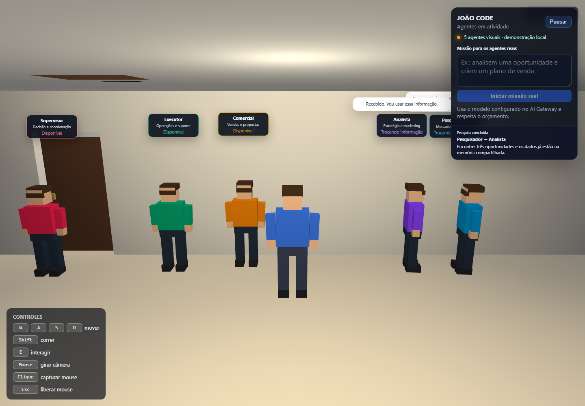
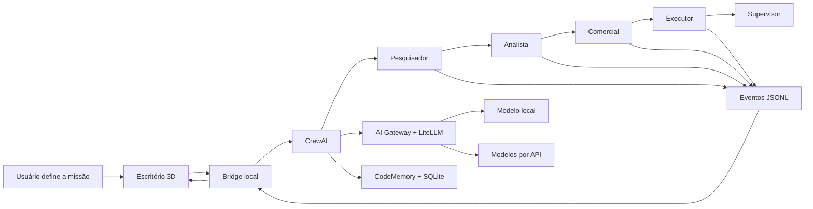

# João Code — AI Office

> Um escritório 3D inspirado em jogos sociais, onde agentes de IA especializados
> recebem uma missão, colaboram e repassam entregas enquanto o usuário acompanha
> o trabalho visualmente.

[](https://react.dev/)
[](https://playcanvas.com/)
[](https://www.python.org/)
[](https://www.crewai.com/)
[](LICENSE)

**[Abrir demonstração pública](https://donmtys.github.io/joao-code-ai-office/)**



## O que o projeto demonstra

- Ambiente 3D navegável construído com React e PlayCanvas.
- Cinco agentes especializados: Pesquisador, Analista, Comercial, Executor e Supervisor.
- Orquestração sequencial real com CrewAI.
- Avatares que caminham até o próximo agente durante um repasse.
- Eventos locais em tempo real entre Python e navegador.
- AI Gateway central com LiteLLM e níveis `CHEAP`, `MEDIUM`, `PREMIUM` e `LOCAL`.
- Limite mensal de gastos e bloqueio de novas chamadas ao atingir o orçamento.
- Memória persistente em SQLite e métricas de economia de contexto.
- Redação de credenciais antes de exibir resultados no cenário.

## Arquitetura



O cenário público funciona em modo demonstrativo e não possui credenciais. A
execução real fica restrita ao computador onde o backend foi configurado.

## Execução rápida da demonstração

Requisitos: Node.js 20 ou superior.

```bash
npm install
npm run dev
```

Abra `http://127.0.0.1:5173`.

## Execução com agentes reais

Requisitos: Python 3.11, Node.js 20 e um modelo local ou provedor configurado.

```bash
cd backend
python -m venv venv

# Windows
venv\Scripts\python -m pip install -r requirements.txt
copy .env.example .env

# Linux/macOS
# venv/bin/python -m pip install -r requirements.txt
# cp .env.example .env
```

Configure os modelos em `backend/.env`. Para iniciar a interface e o bridge:

```bash
npm run dev:office
```

Digite uma missão no painel. O backend utiliza o AI Gateway, respeita o orçamento
configurado e envia ao cenário apenas eventos resumidos e sanitizados.

## Testes

```bash
npm run build

cd backend
python -m unittest discover -s tests -p "test_agent_office_events.py" -v
python -m unittest discover -s tests -p "test_p0_agents.py" -v
```

Os testes do gateway usam mocks e não precisam consumir tokens pagos.

## Segurança e custos

- Chaves ficam somente no `.env`, que é ignorado pelo Git.
- O bridge aceita execução apenas de origens locais autorizadas.
- A demonstração pública não consegue iniciar APIs no computador do autor.
- Conversas visuais de demonstração não chamam modelos.
- O gateway impede chamadas pagas quando o limite mensal é atingido.

## Tecnologias

React · TypeScript · PlayCanvas · Vite · Python · CrewAI · LiteLLM · Ollama · SQLite · SSE

## Autor

**João Victor Da Costa Cruz** — [GitHub @DonMtys](https://github.com/DonMtys)

Projeto de portfólio focado em sistemas multiagentes, IA local, controle de custos
e interfaces 3D para observabilidade.

